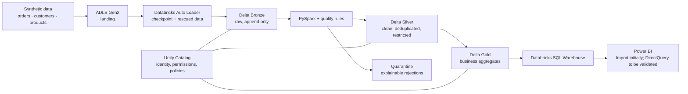

# TT E-commerce Lakehouse

> **Language:** English · [Español](README.md)

A project to design a fictional table-tennis equipment e-commerce and its governed analytics platform on Azure. The goal is not to operate a real store: it is to demonstrate how to turn synthetic sales events into reliable business metrics while keeping access to personal data under control.

## Summary: result and evidence

**Published, privacy-safe business metric:** category **paddle** / region **ES-MD** / channel **web** = **EUR 640.00** net revenue, **5 orders**, **0 refunded lines** — the only cell that passes the k ≥ 5 threshold (pre-suppression controls: EUR 812.20 / 13 / 2). The full path contract → Bronze → Silver/quarantine → Gold on Azure Databricks + Unity Catalog + Terraform, with **287 local tests passing**:

```powershell
py -m unittest discover -s tests -v
```

- [Business case and the metric](docs/evidencia/01-caso-negocio.md) (Spanish)
- [Pipeline correction: two real cloud incidents and their versioned fixes](docs/evidencia/02-correccion-del-pipeline.md) (Spanish)
- [Databricks jobs and UC governance: manual serverless bundle, separated SP, least privilege](docs/evidencia/03-databricks-jobs-y-ejecucion.md) (Spanish) · [Governance IaC](docs/evidencia/04-unity-catalog-y-gobierno.md) (Spanish)
- **Evidence documentation:** [docs/evidencia/README.md](docs/evidencia/README.md) (Spanish) — index, declared limitations and [technical X-ray with versioned paths](docs/evidencia/06-radiografia-del-proyecto.md) (Spanish).
- **Static demo:** [demo/index.html](demo/index.html) (fixed result content, no cloud calls, no SQL Warehouse or Power BI; instructions in [demo/README.md](demo/README.md), Spanish).

**Scope honesty:** this project's cloud results (the single Bronze ingestion of `DEMO-001` and the Silver milestone, with Silver 15/10/7, quarantine 6 and status `COMPLETED_WITH_QUARANTINE`) are **operator-reported evidence** — human observation and console output from the documented run, neither reproducible from Git nor formal audit evidence. What this repository accredits by itself is what is committed: code, bundle, Terraform, fixture and the 287 local tests. The data is **100% synthetic**: the PII-shaped fixture fields (email, phone, customer identifiers) are **deterministically generated test data** (test domains `*.example.test`, fictitious `+3400…` phone numbers), never real people or contacts. **Phase 2 is not formally closed** (exception-qualified closure still unsigned) and Bronze `DEMO-001` was frozen after its single ingestion. **Not started:** SQL Warehouse, Power BI, live dashboard, CI/CD, monitoring, dynamic masking, or consumer identity proof. The **screenshots for the evidence documentation do not exist yet** (pending authenticated manual capture and redaction: [evidence plan](docs/evidencia/evidence/README.md), Spanish).

> **Current status:** Phases 0 and 1 closed according to user-reported evidence. **Phase 2 — the Bronze ingestion of batch `DEMO-001` ran in the cloud exactly once and was independently verified in read-only mode (operator-reported evidence); full validation remains unformalized.** The exception-qualified closure document ([unsigned draft](docs/fase-2/EVIDENCIA_CLOUD_DEMO-001_CIERRE_EXCEPCION_BORRADOR.md), Spanish) remains `SIN FIRMAR` (unsigned) — RE-PA-1/RE-PA-2 without in-window evidence and P-2/P-3 deferred —, no GF2 gate is signed and **Phase 2 is not declared closed**. Bronze is **frozen**: no re-executions, no `landing` mutations and no checkpoint resets.
>
> **Phase 3 — Silver `DEMO-001` milestone executed in the cloud and verified in read-only mode per the operator report** (preconditions, deployment, runs, controls and limits in the [evidence acta](docs/fase-3/ACTA_EVIDENCIA_CLOUD_DEMO-001.md), Spanish): Silver orders/customers/products **15/10/7** rows, quarantine with **6 expected rejections**, Gold with a **single current privacy-safe cell** (paddle / ES-MD / web = **EUR 640.00** / **5 orders** / **0 refunded lines**, no PII or identifiers), run status `COMPLETED_WITH_QUARANTINE` and **all read-only verifier checks green**. Declared, bounded scope: a full batch snapshot via scoped `replaceWhere` with a deterministic audit timestamp — it is **not** streaming/CDC/SCD/generic incremental/MERGE and it is **not** atomic across output tables. **Not started:** SQL Warehouse, Power BI, dashboards, final CI/runbooks and generic incremental/CDC design.
>
> The local preparation of Phases 2–3 is complete and committed: **287 `unittest` tests passing across 13 suites**, without cloud credentials (Terraform 1.16.6 and Databricks CLI 1.22.1 installed; `validate` of `bootstrap`/`platform` OK on this host, while the one for `infra/databricks` belongs to the operator from an authorized host). The cloud evidence recorded in the documentation is **operator-reported** (console outputs supplied in the documentation session) and is explicitly distinguished from the repository's committed evidence. The Bronze deployment hardening (landing root fixed by the bundle, exact directory audited before DDL, Auto Loader scoped to the approved file and `CREATE_TABLE` on `bronze` reserved to the run-as) is detailed in the [Phase 2 status section](#phase-2-status-local-closure-complete-cloud-evidence-reported-closure-unsigned).

## Problem and business narrative

The fictional store sells paddles, rubbers, balls, tables, nets and accessories. Operations and commercial want to answer questions such as:

- Which categories, regions and channels generate the most revenue and orders?
- Which products have the best turnover, and which orders have been refunded?
- How does daily billing evolve without exposing customer contact data to BI-only consumers?

The operational source is simulated with order, customer and catalog files or events. The platform will keep the origin for traceability, and will clean and conform the data before publishing aggregates fit for analysis.

## Goals and scope

### MVP

- Reproducible **synthetic** data: JSONL orders and customer/catalog CSV files, with duplicates, cancellations, nulls and controlled schema-change cases.
- ADLS Gen2 lake and incremental loading into Delta Bronze via Databricks Auto Loader, with checkpoints and capture of uninterpretable records (`rescued data`).
- PySpark transformations into Silver: schema contract, typing, idempotent deduplication, quality rules, quarantine and audit columns.
- Unity Catalog for governance: in Phase 1, according to the user report, the authorized apply completed and verified the base UC objects — synthetic catalog `tt_ecommerce_synthetic` with catalog-level managed storage under a dedicated exclusive child path, empty schemas `bronze`, `silver`, `quarantine` and `gold`, and minimal grants for a single existing writer group—, with direct reads of objects and grants as reported evidence; nothing beyond that evidence is claimed. Dynamic masking policies will be implemented and tested in Phase 4.
- Aggregated Gold tables with no PII columns by design, for general consumption. The SQL Warehouse will be created in Phase 5, only after its cost gate, before the initial Power BI report.
- Terraform as declarative infrastructure, with protected remote state once the backend is available; state and credentials are never committed.

### Extensions (beyond the MVP)

- CDC or streaming of orders, SCD type 2 for customers/products and scheduled orchestration.
- Operational alerts, richer catalog/lineage, performance testing and CI/CD deployment.
- Advanced re-identification risk analysis and additional controls for dimension combinations; the basic publication criteria are already part of the MVP.
- Evaluation of DirectQuery versus Import in Power BI based on latency, semantic model and SQL Warehouse cost.

## Proposed architecture



Expected flow:

1. A deterministic generator produces synthetic data and a run manifest.
2. Files arrive in the `landing` area of ADLS. Auto Loader discovers only new files and persists its progress in the checkpoint.
3. Bronze stores the received payload, ingestion metadata, source file and source system append-only.
4. Silver applies the contract, normalizes types and codes, keeps audit columns and performs an idempotent `MERGE` on a business key and an event/version marker. Invalid records are diverted to quarantine, not silently corrected.
5. Gold recomputes explicit windows over a complete Silver snapshot and publishes order, revenue, category, region and status metrics. A refresh must be able to drop stale results for one date without altering dates outside its window.

## Initial data model

| Entity | Example fields | Use |
| --- | --- | --- |
| `orders` | `order_id`, `line_id`, `customer_id`, `product_id`, `order_date`, `status`, `quantity`, `revenue`, currency | Sales, return or cancellation facts. Initial grain: order line (`order_id` + `line_id`). |
| `customers` | `customer_id`, country/region, email, phone, audit dates | Customer relationship; synthetic, restricted contact data. |
| `products` | `product_id`, name, category, brand, price | Catalog dimension: paddles, rubbers, balls, tables and accessories. |

Order deduplication is defined over `order_id` + `line_id` and an event-time/version marker; a correction or refund must replace that line's current state without erasing Bronze evidence. Revenue metrics use the net of current versions and contract-defined statuses, while orders are counted as `count(distinct order_id)` so line counts do not inflate them. Keys, formats and semantics are documented in Phase 0; infrastructure sizing is decided before deployment. The synthetic data must not copy real identities or contacts.

## Layers, consumers and access

| Layer | Purpose | Intended permitted consumers |
| --- | --- | --- |
| Bronze | Immutable raw evidence for replay and diagnostics. | Data engineering with an operational need. |
| Silver | Clean, conformed data; may contain controlled identifiers and contact details. | Engineering and stewardship with justified need; authorized analysts, only via an approved view/subset with masked contact. It will not be opened indiscriminately. |
| Quarantine | Rejected rows and rejection reason. | Data engineering / authorized support. |
| Gold | Published business metrics and dimensions. | Analytics, SQL Warehouse and Power BI according to permissions. |

The concrete roles/groups will be created or mapped to real identities available in the tenant; these names are provisional and do not replace that verification:

| Group | Intended access |
| --- | --- |
| `data-engineers` | Bronze/Silver/quarantine needed to operate pipelines; original email/phone only if their function requires it. |
| `customer-data-stewards` | Justified Silver subset for customer data management; original contact. |
| `silver-analysts-authorized` | Only an approved Silver view or subset; dynamically masked email/phone. No general `SELECT` on Silver tables. |
| `bi-executives` | Only published Gold views/tables via the SQL Warehouse/Power BI; no Bronze, Silver or quarantine. |

The Phase 1 UC control plane is, according to the user report, applied and verified: metastore assigned with an empty DEFAULT root by approved decision; catalog `tt_ecommerce_synthetic` with catalog-level managed storage in an exclusive child path under the dedicated storage (without requiring an additional DEFAULT managed location); credential/external location; four empty schemas and the minimal grant of the single writer group (`USE_CATALOG`; per schema, `USE_SCHEMA`/`CREATE_TABLE`), checked with direct reads of objects and grants and a non-administrator writer identity test (positive on catalog/schemas, negative on external location/credential). The IaC does not declare grants for analysts, BI, stewardship or `account users`, and that does not prove those are the only effective accesses: inherited/pre-existing grants and owners may prevail, so no effective control is claimed beyond the reported evidence. The first Phase 2 ingestion was subject to its own gates (dedicated pipeline identity, access only to `landing` with `READ_FILES`, the `pipeline_state.ingestion_state` volume and minimal table privileges), which remain **unsigned** after the cycle executed per the operator report. Dynamic masking is Phase 4 work; it is not declared configured and no real PII will be loaded.

Gold will avoid publishing PII by design. That does not guarantee a low-cardinality aggregate cannot permit inferences; before exposing it, minimum-size, suppression or generalization criteria will be defined according to the use case.

## Security and data management

- Least-privilege principle across managed identities, ADLS, Databricks, Unity Catalog and BI consumers.
- Secrets in Key Vault or the approved corporate mechanism, referenced at runtime. There will be no secrets, tokens, Terraform state files or sensitive configuration values in Git.
- If derived identifiers are needed, a salted hash managed as a secret with rotation will be evaluated. A hash is not automatically anonymization and does not remove the need for access controls.
- Minimization, retention, deletion and auditing are design goals still to be concrete with business and platform requirements. This project does not claim certification or GDPR compliance.

## Planned stack

- Azure Data Lake Storage Gen2 for landing and Delta storage.
- Azure Databricks: Auto Loader, PySpark, Delta Lake, Workflows and SQL Warehouse.
- Unity Catalog for metadata, permissions, available auditing and column policies.
- Power BI for Gold consumption.
- Terraform for infrastructure and configuration supported by the provider in the chosen environment; coverage and prerequisites will be validated at implementation time.
- Python/PySpark, SQL, quality tests and CI for the data code.

## Decisions, prerequisites and cost

- The intended region for `platform` and for the optional `bootstrap` backend is **France Central**. The Azure assistant showed a new-customer admission warning for West Europe and did not show it for France Central; that is a signal observed by the user, not a guarantee of quota, Free Trial or Premium coverage. The user reports that the `platform` remote backend works and that Stage 1 and Stage 2 were applied; there is no direct cloud evidence in this repository. After isolating the Azure CLI authentication from the provider, the authorized `databricks` apply completed the remaining fourteen UC resources. The final reported evidence confirms direct reads of UC objects and grants, and a non-administrator writer test with catalog/schema reads allowed and external location/credential access denied. After removing the temporary Global Administrator from cloud/UC administration, the Databricks administrative profile kept working and the final plan converged with 0 additions/changes/destructions. The user reports a EUR 50 monthly subscription budget with alerts created; related forecast charges are attributed to other projects in the subscription, not to this project.
- Registered decision G5 allows public Storage and Databricks endpoints from any network for authenticated principals, without allowlist, exclusively with synthetic data. TLS, RBAC and anonymous blobs disabled do not equal a private network or GDPR compliance; no real data/PII will be loaded and Private Link/VNet remains deferred.
- Unity Catalog requires the workspace, metastore, managed storage/external locations, identities and permissions to be prepared compatibly with the chosen Azure/Databricks configuration. Approved decision: the DEFAULT root of the existing metastore is neither set nor modified; it remains empty. The updated code places the managed storage of `tt_ecommerce_synthetic` in an exclusive child path under the separate dedicated storage, while `lakehouse` stays isolated for its external location. This avoids the provider 1.80 ForceNew risk on an existing metastore root and the ambiguity between root/external location. Stage 3 (dedicated storage/connector/RBAC) is reported as applied. The user reports that the cloud-only identity keeps the necessary Databricks roles after removing the temporary Entra Global Administrator from cloud/UC administration. Databricks CLI v1.22.1 is installed and a local workspace OAuth profile, created by that administration, authenticated `current-user me` with exit 0. A non-administrator cloud-only identity, an engineering account group and its membership were created; the group received only Workspace access, no consumer/SQL/admin, unrestricted clusters and no pools. The base UC objects and their grants are reported as applied/verified; no future plan may mutate or replace the metastore.
- The state backend uses an independent Storage Account with a public endpoint without allowlist only for authenticated Entra/RBAC principals, private container, Shared Key and local users disabled, OAuth by default and 7-day blob/container versioning/soft delete. It is a network exception separate from G5: `tfstate` is sensitive (IDs and potentially sensitive resource values), contains no PII by design and does not become public for having a public endpoint; it does not equal a private network or GDPR compliance. The user reports that bootstrap created the state RG, a Standard LRS Storage Account and the private `tfstate` container in France Central, and then the container role assignment for the current CLI identity. Bootstrap's own state remains local. The earlier platform init was initially local due to a missing backend block; the user reports the platform remote backend was configured before the Stage 1 apply.
- Final topology, SKUs, shutdown schedules, retention and compute size will be decided after a volume and budget estimate. The SQL Warehouse remains as disabled opt-in code and will not be created in Phase 1; its creation in Phase 5 requires a cost review before Power BI.
- Some Databricks/Azure operations may require administrative steps or may be unavailable in the chosen provider version; they will be checked at deployment time instead of assuming full support.
- For AzureRM 4.30.0, the `platform`/`bootstrap` roots will use `resource_provider_registrations = "none"`: they will not auto-register providers. A later plan will require CLI Owner login and `ARM_SUBSCRIPTION_ID` locally only; never committed or shared. Before the authorized bootstrap plan, the `Microsoft.Storage`, `Microsoft.Authorization` and `Microsoft.Databricks` registrations are inspected read-only.
- The user reports Stage 1 of `platform` (foundation, Storage HNS, private containers, workspace, Access Connector and scoped RBAC) and successful Entra read probes. The user also reports that Stage 2, reviewed and authorized separately, created exactly seven Gen2 routes with no changes or destructions: `landing/orders`, `landing/customers`, `landing/products`, `lakehouse/bronze`, `lakehouse/silver`, `lakehouse/quarantine` and `lakehouse/gold`. The two local Stage 2 flags remain `true` and must never be reset to `false`, as they would destroy the routes; do not use `-target`. This does not imply CI/UC access or authorization of future applies.

## Trying Phase 0 locally

Requires Python 3.13; the generator and its tests use only the standard library. On Windows, from the repository root:

```powershell
py scripts/generate_synthetic_data.py --seed 42 --batch-id DEMO-001
py -m unittest discover -s tests -v
```

On macOS/Linux, `py` can be replaced with `python3`. The batch is saved to `data/generated/DEMO-001/` (ignored by Git); `data/sample/DEMO-001/` contains a reproducible versioned example with the same seed. **It contains deliberate anomalies** —including a malformed JSON line— to exercise quality rules; it must not be treated as a fully valid source and it contains no real contacts. Amounts, metrics and expected rules are specified in [Phase 0](docs/fase-0/CONTRATOS.md) (Spanish).

## Phase 2 status (local closure complete; cloud evidence reported, closure unsigned)

The local preparation of Phase 2 is **complete**, and the cloud cycle of the first `DEMO-001` ingestion ran according to the operator report: a single ingestion independently verified in read-only mode (counts 26/11/7 with anomalies, provenance, checkpoints and run-log present) and **Bronze frozen** since then. What remains pending is **formalization**: no GF2 gate signatures, session logs to be filled in and the exception-qualified closure ([draft](docs/fase-2/EVIDENCIA_CLOUD_DEMO-001_CIERRE_EXCEPCION_BORRADOR.md), Spanish) `SIN FIRMAR` (unsigned). Local factual status:

- **Tests:** `py -m unittest discover -s tests -v` runs **287 tests** passing across **13 versioned suites** ([F0 generator/fixture](tests/test_generate_synthetic_data.py); Bronze core/entrypoint/bundle/promotion/preflight/verification: `test_bronze_core`, `test_bronze_entrypoint`, `test_bronze_job_bundle`, `test_bronze_promotion`, `test_bronze_remote_preflight`, `test_bronze_verification_job`; Silver core/adapter/verifier/bundle: `test_silver_core`, `test_silver_spark`, `test_silver_verifier`, `test_silver_job_bundle`; Terraform privilege separation: `test_phase2_terraform`, `test_phase3_terraform`). These tests use no cloud credentials: they do not accredit workspace execution.
- **Installed tooling:** Terraform 1.16.6 windows_amd64 and Databricks CLI 1.22.1. `terraform validate` of `infra/bootstrap/` and `infra/platform/` passed on this host; the `validate` of `infra/databricks/` **cannot run here** (the host's Application Control blocks the provider startup): the operator must validate and plan that root from an authorized host, and only afterwards consider the GF2-5 plans.
- **Runbook commands already materialized:** the job command and the promotion operation already exist as artifacts — `scripts/promote_batch.py` (`plan`/`publish`) for the operator and `scripts/run_bronze_job.py` as the task's root script — and the bundle (`databricks.yml`, `resources/*.yml`) defines the job with `max_concurrent_runs: 1`, `max_retries: 0`, no schedule, `timeout_seconds: 3600` per task and targets `development_serverless`/`development_classic`. None of this by itself authorizes a `deploy`/`run`.
- **Implementation hardening (local preparation, not cloud evidence):**
  - `landing_root` is deployment configuration and not a run parameter: the job exposes only `batch_id`/`arrival_date`; the bundle passes `--landing-root=${var.landing_root}` as a **fixed** task argument, strictly validated by `layout.validate_landing_root` as the exact container root (`abfss://landing@<account>.dfs.core.windows.net`, without subpath/query/fragment/port or another container).
  - The remote preflight adds an **exact-directory audit** per source (metadata-only listing via `_metadata.file_path`): only the contract-approved file, rejecting extra files or subdirectories before reading bytes and before any DDL/stream (no `content`, no byte push to the driver).
  - The Auto Loader is filtered to the **contractually approved file name** via a literal-validated `pathGlobFilter` (`validate_source_filename`), always reading the batch directory and never an individual file URI; the preflight receipt must carry exactly that name (`validate_receipt_filename`) before starting streams.
  - Reviewed ownership separation: `engineer_writer` keeps `CREATE_TABLE` only on `silver`/`quarantine`/`gold`; `CREATE_TABLE` on `bronze` is reserved to the job's run-as (`databricks_grant.phase2_job_bronze_schema`), which remains the sole first creator/owner of the raw tables and the log, with no pre-creation by Terraform/admin.
- Classic 30-minute auto-termination and the 3600 s task timeout are declared limits; no pre-existing Phase 2 plan/apply executed them here.

## Planned execution on Azure

When the infrastructure is implemented, the repository will document its exact commands and variables. At a high level, the execution is (steps 1–3 already happened according to the operator report; 4 and 5 remain future):

1. (Phase 1 closed according to user report) Azure foundation applied authorizedly and verified read-only: France Central, subscription/tenant, `platform` remote backend, Stages 1–3 with the seven Gen2 routes and operator probes; no resources are created manually from the portal.
2. (Phase 1 closed according to user report) Base UC applied and verified: metastore assigned with an empty DEFAULT root by approved decision, credential/external location, catalog `tt_ecommerce_synthetic` with catalog-level managed storage in an exclusive child path, four empty schemas and the minimal grant of the single writer group; no additional DEFAULT managed location is required or declared, and no future plan mutates or replaces the metastore.
3. Phase 2 (**executed exactly once in the cloud according to the operator report; full validation unformalized, exception-qualified closure unsigned**): approve the job's dedicated run-as identity —sole first creator/owner of the raw tables and the log, with Terraform declaring only `CREATE_TABLE` on `bronze` (reserved to the run-as; `engineer_writer` keeps it on `silver`/`quarantine`/`gold`) and no pre-creation—, the Reader connector on the `landing` container and the **four sub-route external locations** (`orders`, `customers`, `products`, `_control`) with `READ_FILES` only for the job (which does not read `_staging`), and the `pipeline_state.ingestion_state` UC state volume with its canonical paths, via three separately authorized Terraform plans/applies (each with a reviewed plan and no unexpected destructions; the `validate`/`plan` of `infra/databricks` runs from its authorized host since this host does not start that provider); then configure the bundle's `landing_root` (exact container root, validated by `layout.validate_landing_root`) before any `bundle deploy`, upload the `DEMO-001` batch authorizedly (producer/operator only) to `landing/_staging` with `scripts/promote_batch.py plan`/`publish`, and run the Bronze ingestion with compute approved per execution via `databricks bundle run` with `--batch_id`/`--arrival_date` (`landing_root` is not a run parameter). **Bronze is frozen after the single ingestion: no re-run, no `landing` mutation and no checkpoint resets.**
4. Phase 3 (`DEMO-001` milestone **executed and verified read-only per the operator report**; generic scope deferred): run Silver, review quarantine and quality metrics; only then refresh Gold.
5. Not started: complete Phase 4 permission and masking tests per identity; in Phase 5, create the SQL Warehouse only after the cost gate and connect Power BI.

On 2026-11-03 the user validated the three roots offline with temporary Terraform 1.13.5 Windows amd64 (official SHA256): `platform` (azurerm 4.30.0; after fixing the deprecated scope, `fmt -check -recursive` and `validate` with no warnings), `bootstrap` (azurerm 4.30.0; fmt/init/validate correct) and the then-existing version of `databricks` (provider 1.80.0; fmt/init/validate correct). After the remediated UC apply, the user reports direct read-only verifications of the created UC objects and their grants, catalog/schema read access for a non-administrator writer identity and external location/credential denials for that identity. After creating the EUR 50 monthly budget with alerts and removing the temporary Global Administrator from cloud/UC administration, the Databricks administrative profile kept working and the final `databricks` plan converged with 0 additions, 0 changes and 0 destructions. The reported inventory shows 0 clusters, 0 jobs and a single pre-existing stopped SQL Warehouse; Terraform keeps the Warehouse disabled and did not create it. At that date there was no synthetic data, jobs or compute started by the project. With these limitations, Phase 1 is closed according to user report; the future data, jobs, compute and SQL/BI consumption phases remain separate work (the subsequent Phase 2–3 cloud cycle is recorded in the 2026-11-12 paragraph). This documentation is not independent cloud evidence.

On **2026-11-09** the local closure of Phase 2 preparation was completed and verified in this repository: the **135 tests** of `py -m unittest discover -s tests -v` pass (six versioned suites plus the local `tests/test_phase2_terraform.py` suite, uncommitted at the time, which fixes the privilege separation — `engineer_writer` without `CREATE_TABLE` on `bronze`, run-as with it) and the deployment hardening was incorporated (landing root fixed by the bundle and validated as the container root, exact directory audited per source before DDL, Auto Loader scoped to the approved file name and job without a `landing_root` parameter). With Terraform 1.16.6 installed, the `terraform validate` of `infra/bootstrap/` and `infra/platform/` passed on this host; the one for `infra/databricks/` is **blocked by Application Control when starting the provider on this host**, so that root requires validation/plan from the operator's authorized host. Databricks CLI 1.22.1 is installed. None of the above executed `plan`/`apply` of the new Phase 2 objects, `bundle deploy`/`run`, or touched the workspace: **as of that date** there was still no cloud evidence for Phase 2 and no GF2 gate was approved.

On **2026-11-12** the documentation records the cloud evidence **reported by the operator** (console outputs supplied in the documentation session; not re-executed from this repository): the Bronze ingestion of `DEMO-001` ran **exactly once** and was independently verified in read-only mode (counts **26/11/7**, with evidence of anomalies, provenance, checkpoints and run-log; Bronze frozen since then: no re-run, no `landing` mutation and no checkpoint resets), and the Phase 3 Silver `DEMO-001` milestone was materialized and verified in the cloud (Silver **15/10/7**, quarantine **6**, one privacy-safe Gold cell **EUR 640.00 / 5 orders / 0 refunded lines**, `COMPLETED_WITH_QUARANTINE`, read-only verifier green; details in the [Phase 3 acta](docs/fase-3/ACTA_EVIDENCIA_CLOUD_DEMO-001.md), Spanish). No GF2 gate is **signed** and the Phase 2 exception-qualified closure remains **unsigned**: **Phase 2 is not declared closed**. The local suite stands at **287 tests** passing.

## Roadmap

The phase plan with dependencies, deliverables and verifiable criteria is in [docs/PLAN_DE_DESARROLLO.md](docs/PLAN_DE_DESARROLLO.md) (Spanish). The closed Phase 0 covers [contracts](docs/fase-0/CONTRATOS.md#acta-de-decisiones-f0-v1), [metrics and quality](docs/fase-0/METRICAS_Y_CALIDAD.md) and [lineage and privacy](docs/fase-0/LINAJE_Y_PRIVACIDAD.md) (Spanish). Phase 1 is closed according to user report: [architecture and decisions](docs/fase-1/ARQUITECTURA_Y_DECISIONES.md), [gates](docs/fase-1/GATES_DESPLIEGUE.md), [guided deployment guide](docs/fase-1/GUIA_DESPLIEGUE_GUIADO.md) and [development cycle](docs/fase-1/CICLO_DE_DESARROLLO.md) (Spanish). **Phase 2 has its local closure complete (deployment hardening included) and its first cloud ingestion executed according to the operator report; full validation is not formalized: no GF2 gate signed and the exception-qualified closure is unsigned** (the job's run-as identity as sole creator/owner of Bronze, with `CREATE_TABLE` on `bronze` reserved to the run-as; Reader connector on the `landing` container and **four sub-route external locations** with `READ_FILES` only for the job, no `_staging` access; the `pipeline_state.ingestion_state` UC state volume; separately authorized sequenced plans/applies; irreversible flags after the apply; `landing_root` fixed as bundle configuration before `bundle deploy`, not a run parameter; authorized `DEMO-001` upload by producer/operator only and per-execution approved ephemeral compute with a 3600 s task timeout): [architecture and decisions](docs/fase-2/ARQUITECTURA_Y_DECISIONES.md), [gates](docs/fase-2/GATES_DESPLIEGUE.md), [validation runbook](docs/fase-2/RUNBOOK_VALIDACION.md), [cloud evidence template](docs/fase-2/EVIDENCIA_CLOUD_TEMPLATE.md) and [unsigned exception-qualified closure draft](docs/fase-2/EVIDENCIA_CLOUD_DEMO-001_CIERRE_EXCEPCION_BORRADOR.md) (Spanish). **Phase 3 materialized its Silver `DEMO-001` milestone in the cloud and verified it read-only per the operator report** ([evidence acta](docs/fase-3/ACTA_EVIDENCIA_CLOUD_DEMO-001.md), Spanish); the phase's generic scope (incremental/MERGE/streaming/SCD) remains **deferred**. Phase 4 will apply masking and access tests, and Phase 5 will enable SQL Warehouse/Power BI after the cost gate (not started). No local evidence accredits a started SQL Warehouse, Power BI or regulatory compliance.

To control spend in future sessions, the workspace and ADLS are kept and compute is stopped; the planned procedure is in [development cycle](docs/fase-1/CICLO_DE_DESARROLLO.md) (Spanish). Workspace/ADLS Stage 1 and the base UC plane are described only according to the user report. The recorded Phase 2–3 cloud execution (single Bronze ingestion and the Silver `DEMO-001` milestone) is evidence **reported by the operator**, with the Phase 2 closure **unsigned** ([exception-qualified draft](docs/fase-2/EVIDENCIA_CLOUD_DEMO-001_CIERRE_EXCEPCION_BORRADOR.md), Spanish, which no gate signs yet); there is no started SQL Warehouse, Power BI or active schedules declared by the project.

---

*Note on language: the linked documentation (`docs/evidencia/`, `docs/fase-*`, `docs/PLAN_DE_DESARROLLO.md`) and the static demo instructions remain in Spanish; they are not translations of this file.*
