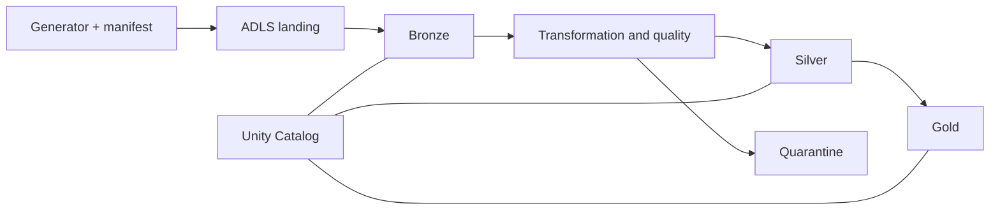

# TT E-commerce Lakehouse

> **Language:** English · [Español](README.md)

A governed lakehouse that turns 100% synthetic e-commerce data into analytical metrics through contracts, quality controls, and access controls. It is not an operational store and does not process real personal data.

## What it demonstrates

The completed milestone takes a contract-bound batch from its generator and manifest to a protected Gold metric. SQL Warehouse and Power BI are future/not-started work; they are not part of the executed flow.



- The generator produces a deterministic batch with files and a manifest.
- Bronze retains raw ingestion; Silver applies the contract and sends rejections to quarantine.
- Gold publishes only aggregates suitable for analytical consumption.

| Segment | Versioned local evidence |
| --- | --- |
| Generation | Script, `DEMO-001` fixture, and contract |
| Landing to Bronze | Preflight, pipeline, and tests |
| Silver and quarantine | Transformation core and tests |
| Gold | k-anonymous aggregation rule and tests |

The diagram summarizes the milestone path, not a generic production architecture.
The governance layer accompanies the tables but does not change the separation between
raw data, conformed data, rejections, and published aggregates.

## Milestone result

The current Gold cell for **paddle · ES-MD · web** is **EUR 640.00**, **5 orders**, and **0 refunded lines**. It is the only published cell and meets **k ≥ 5**.

The Bronze and Silver milestone cloud execution is **operator-reported evidence**: it is neither reproducible from Git nor a formal audit. The repository does version the code, contracts, fixture, and local tests; reported detail is in the [Phase 3 acta](docs/fase-3/ACTA_EVIDENCIA_CLOUD_DEMO-001.md) (Spanish).

Gold includes no PII or identifiers in the published cell.
Suppression is evaluated for the combination of dimensions in that publication.

## Challenges solved

- **Unauthorized files →** an exact-directory audit happens before any DDL, and Auto Loader is limited to the approved file through `pathGlobFilter`.
- **Excess privilege →** the Bronze run-as retains `CREATE_TABLE` on Bronze, while the Silver service principal is separate; writers do not receive that Bronze privilege.
- **Hidden anomalies →** the fixture keeps malformed JSON and schema drift; `_rescued_data`, `_corrupt_record`, and quarantine retain evidence, with no silent correction.
- **Two runtime failures →** they were fixed in the versioned pipeline; evidence of their cloud executions remains operator-reported only, not reproducible proof or an audit. See [pipeline correction](docs/evidencia/02-correccion-del-pipeline.md) (Spanish).

These decisions prioritize making an unexpected batch visibly fail or leave reviewable
evidence. They do not turn the reported execution into audited evidence.

## Local verification

From the repository root:

```powershell
py scripts/generate_synthetic_data.py --seed 42 --batch-id DEMO-001
py -m unittest discover -s tests -v
```

The local suite records **287 tests in 13 suites**, without cloud credentials. It generates `DEMO-001` and validates contracts, pipeline behavior, and privilege separation; it does not accredit workspace execution.

The first command generates the batch and the second runs `unittest`; neither requires cloud credentials.

## Limits and next step

- All data is synthetic.
- Phase 2 is not formally closed, and Bronze was frozen after one operator-reported execution.
- The Silver milestone is bounded: scoped `replaceWhere`; it is not streaming, CDC, generic incremental loading, or `MERGE`, and it is not atomic across outputs.
- SQL Warehouse, Power BI, CI/CD, monitoring, dynamic masking, and consumer-identity testing have not started.

The next priority is to formalize evidence and gates, then add CI/CD and operational monitoring. Scope and outstanding work are in the [development plan](docs/PLAN_DE_DESARROLLO.md) and the [evidence documentation](docs/evidencia/README.md) (Spanish).

Freezing does not replace signed gates; the scope does not solve new windows, continuous changes, or transactional coordination.

## Detailed documentation

The linked detailed documentation remains primarily in Spanish.

- [Evidence index](docs/evidencia/README.md) — limitations and traceability.
- [Silver milestone cloud-evidence acta (Phase 3)](docs/fase-3/ACTA_EVIDENCIA_CLOUD_DEMO-001.md) — reported result and scope.
- [Development plan](docs/PLAN_DE_DESARROLLO.md) — phases, gates, and outstanding work.
- [Phase 0 contracts](docs/fase-0/CONTRATOS.md) — batch formats and rules.
- [Phase 1 decisions](docs/fase-1/ARQUITECTURA_Y_DECISIONES.md) — foundation and governance.
- [Phase 2 decisions](docs/fase-2/ARQUITECTURA_Y_DECISIONES.md) — Bronze ingestion and controls.
