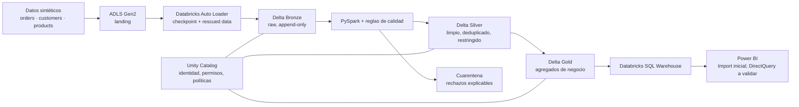

# TT E-commerce Lakehouse

> **Idioma:** Español · [English](README.en.md)

Proyecto para diseñar un e-commerce ficticio de material de tenis de mesa y su plataforma analítica gobernada en Azure. El objetivo no es operar una tienda real: es demostrar cómo transformar eventos de venta sintéticos en métricas fiables para negocio, manteniendo el acceso a datos personales bajo control.

## Resumen: resultado y evidencia

**Métrica de negocio publicada y privacy-safe:** categoría **pala** / región **ES-MD** / canal **web** = **640,00 EUR** de ingresos netos, **5 pedidos**, **0 líneas reembolsadas** — la única celda que supera el umbral k ≥ 5 (controles previos a supresión: 812,20 EUR / 13 / 2). Recorrido completo contrato → Bronze → Silver/cuarentena → Gold sobre Azure Databricks + Unity Catalog + Terraform, con **287 pruebas locales en verde**:

```powershell
py -m unittest discover -s tests -v
```

- [Caso de negocio y la métrica](docs/evidencia/01-caso-negocio.md)
- [Corrección del pipeline: dos incidencias reales en cloud y su arreglo versionado](docs/evidencia/02-correccion-del-pipeline.md)
- [Jobs de Databricks y gobierno UC: bundle manual serverless, SP separado, mínimo privilegio](docs/evidencia/03-databricks-jobs-y-ejecucion.md) · [IaC de gobierno](docs/evidencia/04-unity-catalog-y-gobierno.md)
- **Documentación de evidencia:** [docs/evidencia/README.md](docs/evidencia/README.md) — índice, limitaciones declaradas y [radiografía técnica con rutas versionadas](docs/evidencia/06-radiografia-del-proyecto.md).
- **Demo estático:** [demo/index.html](demo/index.html) (contenido fijo del resultado, sin llamadas cloud, sin SQL Warehouse ni Power BI; instrucciones en [demo/README.md](demo/README.md)).

**Honestidad de alcance:** los resultados cloud de este proyecto (ingesta Bronze única de `DEMO-001` y hito Silver, con Silver 15/10/7, cuarentena 6 y estado `COMPLETED_WITH_QUARANTINE`) son **evidencia reportada por el operador** — observación humana y salidas de consola del run documentado, ni reproducibles desde Git ni evidencia de auditoría formal. Lo que este repositorio acredita por sí mismo es lo versionado: código, bundle, Terraform, fixture y las 287 pruebas locales. Los datos son **100 % sintéticos**: los campos con forma de PII del fixture (correo, teléfono, identificadores de cliente) son **datos de prueba generados determinísticamente** (dominios de prueba `*.example.test`, teléfonos ficticios `+3400…`), nunca personas ni contactos reales. **Fase 2 no está formalmente cerrada** (cierre por excepción sin firmar) y Bronze `DEMO-001` quedó congelado tras su única ingesta. **No iniciados:** SQL Warehouse, Power BI, dashboard en vivo, CI/CD, monitorización, máscaras dinámicas ni prueba de identidad de consumidor. Las **capturas de pantalla de la documentación de evidencia no existen todavía** (pendientes de captura manual autenticada y redacción: [plan de evidencia](docs/evidencia/evidence/README.md)).

> **Estado actual:** Fases 0 y 1 cerradas según evidencia reportada por el usuario. **Fase 2 — la ingesta Bronze del lote `DEMO-001` se ejecutó en cloud una única vez y fue verificada de forma independiente en lectura (evidencia reportada por el operador); la validación completa sigue sin formalizarse.** El documento de cierre por excepción ([borrador sin firmar](docs/fase-2/EVIDENCIA_CLOUD_DEMO-001_CIERRE_EXCEPCION_BORRADOR.md)) permanece `SIN FIRMAR` — RE-PA-1/RE-PA-2 sin evidencia en su ventana y P-2/P-3 diferidos —, ningún gate GF2 queda firmado y **no se declara Fase 2 cerrada**. Bronze queda **congelado**: sin re-ejecuciones, sin mutaciones de `landing` y sin reseteo de checkpoints.
>
> **Fase 3 — hito Silver `DEMO-001` ejecutado en cloud y verificado en lectura según reporte del operador** (precondiciones, despliegue, runs, controles y límites en el [acta de evidencia](docs/fase-3/ACTA_EVIDENCIA_CLOUD_DEMO-001.md)): Silver orders/customers/products **15/10/7** filas, cuarentena con **6 rechazos esperados**, Gold con **una única celda privacy-safe vigente** (pala / ES-MD / web = **640,00 EUR** / **5 pedidos** / **0 líneas reembolsadas**, sin PII ni identificadores), estado de run `COMPLETED_WITH_QUARANTINE` y **todos los chequeos del verificador read-only en verde**. Alcance acotado y declarado: instantánea completa del lote vía `replaceWhere` por scope con timestamp de auditoría determinista — **no** es streaming/CDC/SCD/incremental genérico/MERGE y **no** es atómico entre tablas de salida. **Sin iniciar:** SQL Warehouse, Power BI, dashboard, CI/runbooks finales y diseño incremental genérico/CDC.
>
> La preparación local de Fases 2–3 está terminada y commiteada: **287 pruebas `unittest` en verde en 13 suites**, sin credenciales cloud (Terraform 1.16.6 y Databricks CLI 1.22.1 instalados; `validate` de `bootstrap`/`platform` OK en este host, mientras que el de `infra/databricks` corresponde al operador desde un host autorizado). La evidencia cloud consignada en la documentación es **reportada por el operador** (salidas de consola suministradas en la sesión de documentación) y se distingue explícitamente de la evidencia commiteada del repositorio. El hardening de despliegue Bronze (landing root fijado por bundle, directorio exacto auditado antes del DDL, Auto Loader acotado al archivo aprobado y `CREATE_TABLE` sobre `bronze` reservado al run-as) se detalla en la [sección de estado de Fase 2](#estado-de-la-fase-2-cierre-local-terminado-evidencia-cloud-reportada-cierre-sin-firmar).

## Problema y narrativa comercial

La tienda ficticia vende palas, gomas, pelotas, mesas, redes y accesorios. Operaciones y comercial quieren responder preguntas como:

- ¿Qué categorías, regiones y canales generan más ingresos y pedidos?
- ¿Qué productos tienen mejor rotación y qué pedidos se han reembolsado?
- ¿Cómo evoluciona la facturación diaria sin exponer datos de contacto de clientes a quienes solo consumen BI?

La fuente operativa se simulará con archivos o eventos de pedidos, clientes y catálogo. La plataforma conservará el origen para trazabilidad, depurará y conformará los datos antes de publicar agregados aptos para análisis.

## Objetivos y alcance

### MVP

- Datos **sintéticos** reproducibles: pedidos JSONL y archivos CSV de clientes y catálogo, con casos de duplicados, anulaciones, nulos y cambios de esquema controlados.
- Lago en ADLS Gen2 y carga incremental a Delta Bronze mediante Databricks Auto Loader, con checkpoints y captura de registros no interpretados (`rescued data`).
- Transformaciones PySpark a Silver: contrato de esquema, tipado, deduplicación idempotente, reglas de calidad, cuarentena y columnas de auditoría.
- Unity Catalog para gobernanza: en Fase 1, según el reporte del usuario, el apply autorizado completó y verificó los objetos UC base —catálogo sintético `tt_ecommerce_synthetic` con managed storage a nivel de catálogo bajo un child path exclusivo dedicado, esquemas vacíos `bronze`, `silver`, `quarantine` y `gold`, y grants mínimos para un único grupo escritor existente—, con lecturas directas de objetos y grants como evidencia reportada; sin reclamar nada más allá de esa evidencia. Las políticas de enmascaramiento dinámico se implementarán y probarán en la Fase 4.
- Tablas Gold agregadas sin columnas PII previstas para consumo general. El SQL Warehouse se creará en la Fase 5, únicamente tras su gate de coste, antes del informe Power BI inicial.
- Terraform como infraestructura declarativa, con estado remoto protegido cuando se disponga del backend; el estado y las credenciales nunca se versionarán.

### Ampliaciones (fuera del MVP)

- CDC o streaming de pedidos, SCD tipo 2 para clientes/productos y orquestación programada.
- Alertas operativas, catálogo/lineage más completo, pruebas de rendimiento y despliegue CI/CD.
- Análisis avanzado de riesgo de reidentificación y controles adicionales para combinaciones de dimensiones; los criterios básicos de publicación ya forman parte del MVP.
- Evaluación de DirectQuery frente a Import en Power BI según latencia, modelo semántico y coste del SQL Warehouse.

## Arquitectura propuesta



Flujo esperado:

1. Un generador determinista produce datos sintéticos y un manifiesto de ejecución.
2. Los archivos llegan al área `landing` de ADLS. Auto Loader descubre únicamente archivos nuevos y persiste el progreso en su checkpoint.
3. Bronze almacena el payload recibido, metadatos de ingestión, archivo origen y sistema fuente de forma append-only.
4. Silver aplica el contrato, normaliza tipos y códigos, conserva columnas de auditoría y hace `MERGE` idempotente sobre una clave de negocio y una marca de evento/versión. Los registros inválidos se desvían a cuarentena, no se corrigen silenciosamente.
5. Gold recalcula ventanas explícitas sobre una instantánea completa de Silver y publica métricas de pedidos, ingresos, categoría, región y estado. Un refresco debe poder eliminar resultados obsoletos de una fecha sin alterar fechas fuera de su ventana.

## Modelo de datos inicial

| Entidad | Ejemplos de campos | Uso |
| --- | --- | --- |
| `orders` | `order_id`, `line_id`, `customer_id`, `product_id`, `order_date`, `status`, `quantity`, `revenue`, moneda | Hechos de venta, devolución o cancelación. Grano inicial: línea de pedido (`order_id` + `line_id`). |
| `customers` | `customer_id`, país/región, email, teléfono, fechas de auditoría | Relación con cliente; datos de contacto sintéticos y restringidos. |
| `products` | `product_id`, nombre, categoría, marca, precio | Dimensión de catálogo: palas, gomas, pelotas, mesas y accesorios. |

La deduplicación de pedidos se definirá sobre `order_id` + `line_id` y una versión/marca temporal de evento; una corrección o devolución debe sustituir el estado vigente de esa línea sin borrar la evidencia Bronze. Las métricas de ingresos usarán el neto de las versiones vigentes y estados definidos en el contrato, mientras que los pedidos se contarán como `count(distinct order_id)` para no inflarlos por número de líneas. Las claves, formatos y semántica están documentados en la Fase 0; el volumen de infraestructura se decidirá antes de desplegar. Los datos sintéticos no deben copiar identidades ni contactos reales.

## Capas, consumidores y acceso

| Capa | Propósito | Consumidores permitidos previstos |
| --- | --- | --- |
| Bronze | Evidencia raw e inmutable para replay y diagnóstico. | Ingeniería de datos con necesidad operativa. |
| Silver | Datos limpios y conformados; puede contener identificadores y contacto controlado. | Ingeniería y stewardship con necesidad justificada; analistas autorizados, únicamente mediante una vista/subconjunto aprobado con contacto enmascarado. No se abrirá de forma indiscriminada. |
| Cuarentena | Filas rechazadas y motivo de rechazo. | Ingeniería de datos / soporte autorizado. |
| Gold | Métricas y dimensiones de negocio publicadas. | Analítica, SQL Warehouse y Power BI según permisos. |

Los roles/grupos concretos se crearán o mapearán a identidades reales disponibles en el tenant; estos nombres son provisionales y no sustituyen esa verificación:

| Grupo | Acceso previsto |
| --- | --- |
| `data-engineers` | Bronze/Silver/cuarentena necesarios para operar pipelines; email/teléfono originales solo si su función lo requiere. |
| `customer-data-stewards` | Subconjunto Silver justificado para gestión de datos de cliente; contacto original. |
| `silver-analysts-authorized` | Solo una vista o subconjunto Silver aprobado; email/teléfono enmascarados dinámicamente. Sin `SELECT` general sobre tablas Silver. |
| `bi-executives` | Solo vistas/tablas Gold publicadas a través del SQL Warehouse/Power BI; sin Bronze, Silver ni cuarentena. |

El plano UC base de la Fase 1 está, según el reporte del usuario, aplicado y verificado: metastore asignado con root DEFAULT vacío por decisión aprobada; catálogo `tt_ecommerce_synthetic` con managed storage a nivel de catálogo en un child path exclusivo bajo el almacenamiento dedicado (sin requerir una ubicación administrada DEFAULT); credencial/external location; cuatro esquemas vacíos y el grant mínimo del único grupo escritor (`USE_CATALOG`; por esquema, `USE_SCHEMA`/`CREATE_TABLE`), comprobados con lecturas directas de objetos y grants y una prueba de identidad escritora no administradora (positiva en catálogo/esquemas, negativa en external location/credencial). El IaC no declara grants para analistas, BI, stewardship ni `account users`, y eso no prueba que sean los únicos accesos efectivos: grants heredados/preexistentes y propietarios pueden prevalecer, por lo que no se afirma control efectivo más allá de la evidencia reportada. La primera ingesta de Fase 2 quedó sujeta a sus propios gates (identidad dedicada del pipeline, acceso solo a `landing` con `READ_FILES`, volumen `pipeline_state.ingestion_state` y privilegios mínimos de tablas), que siguen **sin firmar** tras el ciclo ejecutado según el reporte del operador. El enmascaramiento dinámico es trabajo de la Fase 4; no se declara configurado ni se cargarán PII reales.

Gold evitará publicar PII por diseño. Eso no garantiza que un agregado de baja cardinalidad no permita inferencias; antes de exponerlo se definirán criterios de tamaño mínimo, supresión o generalización acordes al caso de uso.

## Seguridad y gestión de datos

- Principio de mínimo privilegio entre identidades administradas, ADLS, Databricks, Unity Catalog y consumidores BI.
- Secretos en Key Vault o en el mecanismo corporativo aprobado, referenciados en tiempo de ejecución. No habrá secretos, tokens, ficheros de estado Terraform ni valores de configuración sensibles en Git.
- Si se necesitan identificadores derivados, se evaluará un hash con salt gestionado como secreto y rotación. Un hash no equivale automáticamente a anonimización ni elimina la necesidad de controles de acceso.
- Minimización, retención, borrado y auditoría son objetivos de diseño pendientes de concretar con requisitos de negocio y plataforma. Este proyecto no declara certificación ni cumplimiento GDPR.

## Stack previsto

- Azure Data Lake Storage Gen2 para aterrizaje y almacenamiento Delta.
- Azure Databricks: Auto Loader, PySpark, Delta Lake, Workflows y SQL Warehouse.
- Unity Catalog para metadatos, permisos, auditoría disponible y políticas de columnas.
- Power BI para el consumo de Gold.
- Terraform para infraestructura y configuración que el proveedor soporte en el entorno elegido; se validará la cobertura y los prerrequisitos al implantar.
- Python/PySpark, SQL, pruebas de calidad y CI para el código de datos.

## Decisiones, prerrequisitos y coste

- La región prevista para `platform` y para el backend opcional `bootstrap` es **France Central**. El asistente de Azure mostró una advertencia de no admisión de nuevos clientes en West Europe y no la mostró en France Central; es una señal observada por el usuario, no una garantía de cuota, Free Trial ni cobertura Premium. El usuario reporta que el backend remoto de `platform` funciona y que Stage 1 y Stage 2 se aplicaron; no hay evidencia cloud directa en este repositorio. Tras aislar la autenticación Azure CLI del provider, el apply autorizado de `databricks` completó los catorce recursos UC que quedaban. La evidencia final reportada confirma lecturas directas de objetos UC y grants, y una prueba de escritor no administrador con lectura de catálogo/esquemas permitida y acceso a external location/credencial denegado. Tras retirar el Global Administrator temporal de la administración cloud/UC, el perfil administrativo de Databricks siguió operativo y el plan final convergió con 0 altas/cambios/destrucciones. El usuario reporta presupuesto mensual de suscripción de 50 EUR con alertas creado; cargos de previsión relacionados se atribuyen a otros proyectos de la suscripción, no a este proyecto.
- La decisión G5 registrada permite endpoints públicos de Storage y Databricks desde cualquier red para principals autenticados, sin allowlist, exclusivamente con datos sintéticos. TLS, RBAC y blobs anónimos deshabilitados no equivalen a red privada ni a cumplimiento GDPR; PII/datos reales no se cargarán y Private Link/VNet queda diferido.
- Unity Catalog requiere que el workspace, metastore, almacenamiento administrado/external locations, identidades y permisos se preparen de forma compatible con la configuración Azure/Databricks elegida. Decisión aprobada: no se fija ni modifica el root DEFAULT del metastore existente; permanece vacío. El código actualizado sitúa el managed storage de `tt_ecommerce_synthetic` en un child path exclusivo bajo el almacenamiento dedicado separado, mientras `lakehouse` queda aislado para su external location. Esto evita el riesgo ForceNew del provider 1.80 sobre el root de un metastore existente y ambigüedad entre root/external location. Stage 3 (storage/conector/RBAC dedicados) está reportado como aplicado. El usuario reporta que la identidad cloud-only conserva los roles Databricks necesarios tras la retirada del Global Administrator Entra temporal de la administración cloud/UC. Databricks CLI v1.22.1 está instalado y un perfil local OAuth de workspace, creado por esa administración, autenticó `current-user me` con salida 0. Se creó una identidad cloud-only no administradora, un grupo de cuenta de ingeniería y su membresía; al grupo se le asignó exclusivamente Workspace access, sin consumer/SQL/admin, clusters sin restricciones ni pools. Los objetos UC base y sus grants están reportados como aplicados/verificados; ningún plan futuro debe mutar o reemplazar el metastore.
- El backend de estado usa un Storage Account independiente con endpoint público sin allowlist solo para principals Entra/RBAC autenticados, contenedor privado, Shared Key y usuarios locales deshabilitados, OAuth por defecto y versionado/soft delete de blob y contenedor de 7 días. Es una excepción de red separada de G5: `tfstate` es sensible (IDs y valores de recurso potencialmente sensibles), no contiene PII por diseño y no se vuelve público por tener endpoint público; no equivale a red privada ni a cumplimiento GDPR. El usuario reporta que bootstrap creó RG de estado, Storage Account Standard LRS y contenedor privado `tfstate` en France Central, y después el role assignment de contenedor para la identidad CLI actual. El estado propio de bootstrap sigue local. El init anterior de platform quedó inicialmente local al faltar bloque backend; el usuario reporta que el backend remoto de platform ya se configuró antes del apply Stage 1.
- La topología final, SKU, horarios de apagado, retención y tamaño de cómputo se decidirán tras una estimación de volumen y presupuesto. El SQL Warehouse permanece como código opt-in desactivado y no se creará en Fase 1; su creación en Fase 5 exige una revisión de coste antes de Power BI.
- Algunas operaciones de Databricks/Azure pueden requerir pasos administrativos o no estar disponibles en la versión del provider elegida; se comprobarán en el momento de despliegue en vez de asumir soporte total.
- Para AzureRM 4.30.0, los roots `platform`/`bootstrap` usarán `resource_provider_registrations = "none"`: no autorregistrarán providers. Un plan posterior requerirá CLI login Owner y `ARM_SUBSCRIPTION_ID` solo local; nunca se versiona ni comparte. Antes del plan bootstrap autorizado se inspeccionan en lectura los registros `Microsoft.Storage`, `Microsoft.Authorization` y `Microsoft.Databricks`.
- El usuario reporta Stage 1 de `platform` (fundación, Storage HNS, contenedores privados, workspace, Access Connector y RBAC acotado) y los probes Entra de lectura correctos. También reporta que el Stage 2, revisado y autorizado por separado, creó exactamente siete rutas Gen2 sin cambios ni destrucciones: `landing/orders`, `landing/customers`, `landing/products`, `lakehouse/bronze`, `lakehouse/silver`, `lakehouse/quarantine` y `lakehouse/gold`. Los dos flags locales de Stage 2 permanecen en `true` y nunca deben resetearse a `false`, pues destruirían las rutas; no usar `-target`. Esto no implica acceso CI/UC ni autorización de futuros applies.

## Probar la fase 0 en local

Requiere Python 3.13; el generador y sus pruebas solo usan la biblioteca estándar. En Windows, desde la raíz del repositorio:

```powershell
py scripts/generate_synthetic_data.py --seed 42 --batch-id DEMO-001
py -m unittest discover -s tests -v
```

En macOS/Linux se puede sustituir `py` por `python3`. El lote se guarda en `data/generated/DEMO-001/` (ignorado por Git); `data/sample/DEMO-001/` contiene un ejemplo versionado reproducible con la misma semilla. **Contiene anomalías deliberadas** —incluida una línea JSON malformada— para probar reglas de calidad; no debe tratarse como fuente completamente válida ni contiene contactos reales. Los importes, métricas y reglas esperadas se especifican en [fase 0](docs/fase-0/CONTRATOS.md).

## Estado de la Fase 2 (cierre local terminado; evidencia cloud reportada, cierre sin firmar)

La preparación local de Fase 2 está **terminada**, y el ciclo cloud de la primera ingesta de `DEMO-001` se ejecutó según el reporte del operador: ingesta única verificada de forma independiente en lectura (recuentos 26/11/7 con anomalías, procedencia, checkpoints y run-log presentes) y **Bronze congelado** desde entonces. Lo que sigue pendiente es la **formalización**: ninguna firma de gates GF2, bitácoras de sesión por rellenar y el cierre por excepción ([borrador](docs/fase-2/EVIDENCIA_CLOUD_DEMO-001_CIERRE_EXCEPCION_BORRADOR.md)) `SIN FIRMAR`. Estado factual local:

- **Pruebas:** `py -m unittest discover -s tests -v` ejecuta **287 pruebas** correctas en **13 suites versionadas** ([generador/fixture F0](tests/test_generate_synthetic_data.py); núcleo/entrada/bundle/promotion/preflight/verificación Bronze: `test_bronze_core`, `test_bronze_entrypoint`, `test_bronze_job_bundle`, `test_bronze_promotion`, `test_bronze_remote_preflight`, `test_bronze_verification_job`; núcleo/adapter/verificador/bundle Silver: `test_silver_core`, `test_silver_spark`, `test_silver_verifier`, `test_silver_job_bundle`; separación de privilegios Terraform: `test_phase2_terraform`, `test_phase3_terraform`). Son pruebas sin credenciales cloud: no acreditan ejecución en el workspace.
- **Herramienta instalada:** Terraform 1.16.6 windows_amd64 y Databricks CLI 1.22.1. `terraform validate` de `infra/bootstrap/` e `infra/platform/` pasó en este host; el `validate` de `infra/databricks/` **no puede ejecutarse aquí** (Application Control del host bloquea el arranque del provider): el operador debe validar y planear ese root desde su host autorizado, y solo después considerar los planes GF2-5.
- **Comandos del runbook ya materializados:** el comando del job y la operación de promoción ya existen como artefactos — `scripts/promote_batch.py` (`plan`/`publish`) para el operador y `scripts/run_bronze_job.py` como root script de la tarea — y el bundle (`databricks.yml`, `resources/*.yml`) define el job con `max_concurrent_runs: 1`, `max_retries: 0`, sin schedule, `timeout_seconds: 3600` por tarea y targets `development_serverless`/`development_classic`. Nada de esto autoriza por sí solo un `deploy`/`run`.
- **Hardening de implementación (preparación local, no evidencia cloud):**
  - `landing_root` es configuración del despliegue y no parámetro del run: el job solo expone `batch_id`/`arrival_date`; el bundle pasa `--landing-root=${var.landing_root}` como argumento **fijo** de la tarea, validado estrictamente por `layout.validate_landing_root` como la raíz exacta del contenedor (`abfss://landing@<account>.dfs.core.windows.net`, sin subruta/query/fragment/puerto ni otro contenedor).
  - El preflight remoto añade una **auditoría del directorio exacto** de cada fuente (listado metadata-only por `_metadata.file_path`): solo el archivo aprobado del contrato, rechazando archivos extra o subdirectorios antes de leer bytes y antes de cualquier DDL/stream (sin `content`, sin push de bytes al driver).
  - El Auto Loader queda filtrado al **nombre de archivo contractualmente aprobado** vía `pathGlobFilter` literal-validado (`validate_source_filename`), leyendo SIEMPRE el directorio del lote y nunca un URI de archivo individual; el recibo del preflight debe llevar exactamente ese nombre (`validate_receipt_filename`) antes de arrancar streams.
  - Separación de propiedad revisada: `engineer_writer` conserva `CREATE_TABLE` solo en `silver`/`quarantine`/`gold`; el `CREATE_TABLE` sobre `bronze` queda reservado al run-as del job (`databricks_grant.phase2_job_bronze_schema`), que sigue siendo el único primer creador/propietario de las tablas raw y del log, sin precreación por Terraform/admin.
- Autoterminación clásica 30 min y timeout de tarea 3600 s son límites declarados; ningún plan/aprove de Fase 2 ya existente aquí los ejecutó.

## Ejecución prevista en Azure

Cuando se implemente la infraestructura, el repositorio documentará sus comandos y variables exactos. A alto nivel, la ejecución será (los pasos 1–3 ya ocurrieron según el reporte del operador; el 4 y el 5 siguen futuros):

1. (Fase 1 cerrada según reporte del usuario) Fundación Azure aplicada autorizadamente y verificada en lectura: France Central, suscripción/tenant, backend remoto de `platform`, Stages 1–3 con las siete rutas Gen2 y probes del operador; no se crean recursos manualmente desde el portal.
2. (Fase 1 cerrada según reporte del usuario) UC base aplicado y verificado: metastore asignado con root DEFAULT vacío por decisión aprobada, credencial/external location, catálogo `tt_ecommerce_synthetic` con managed storage a nivel de catálogo en un child path exclusivo, cuatro esquemas vacíos y el grant mínimo del único grupo escritor; no se requiere ni se declara una ubicación administrada DEFAULT adicional, y ningún plan futuro muta o reemplaza el metastore.
3. Fase 2 (**ejecutada una única vez en cloud según reporte del operador; validación completa sin formalizar, cierre por excepción sin firmar**): aprobar identidad run-as dedicada del job —único primer creador/propietario de las tablas raw y del log, con Terraform declarando solo `CREATE_TABLE` sobre `bronze` (reservado al run-as; `engineer_writer` lo conserva en `silver`/`quarantine`/`gold`) y sin precreación—, el conector Reader en el contenedor `landing` y las **cuatro external locations de subruta** (`orders`, `customers`, `products`, `_control`) con `READ_FILES` solo para el job (que no lee `_staging`), y el volumen UC de estado `pipeline_state.ingestion_state` con sus rutas canónicas, mediante tres planes/aplicaciones Terraform secuenciados y autorizados por separado (cada uno con plan revisado sin destrucciones inesperadas; el `validate`/`plan` de `infra/databricks` se ejecuta desde su host autorizado ya que este host no arranca ese provider); después configurar el `landing_root` del bundle (raíz exacta del contenedor, validada por `layout.validate_landing_root`) antes de cualquier `bundle deploy`, subir autorizadamente (solo productor/operador) el lote `DEMO-001` a `landing/_staging` con `scripts/promote_batch.py plan`/`publish`, y ejecutar la ingesta Bronze con cómputo efímero aprobado por cada ejecución vía `databricks bundle run` con `--batch_id`/`--arrival_date` (el `landing_root` no es parámetro del run). **Bronze queda congelado tras la ingesta única: sin re-run, sin mutar `landing` y sin resetear checkpoints.**
4. Fase 3 (hito `DEMO-001` **ejecutado y verificado en lectura según reporte del operador**; alcance genérico diferido): ejecutar Silver, revisar cuarentena y métricas de calidad; solo entonces refrescar Gold.
5. Sin iniciar: completar en Fase 4 las pruebas de permisos y máscaras por identidad; en Fase 5, crear el SQL Warehouse solo tras el gate de coste y conectar Power BI.

El 2026-11-03 el usuario validó offline los tres roots con Terraform temporal 1.13.5 Windows amd64 (SHA256 oficial): `platform` (azurerm 4.30.0; tras corregir el alcance deprecado, `fmt -check -recursive` y `validate` sin avisos), `bootstrap` (azurerm 4.30.0; fmt/init/validate correctos) y la versión entonces existente de `databricks` (provider 1.80.0; fmt/init/validate correctos). Después del apply UC remediado, el usuario reporta verificaciones directas de solo lectura de los objetos UC creados y sus grants, acceso de lectura a catálogo/esquemas para una identidad escritora no administradora y denegaciones de ubicación externa/credencial para esa identidad. Tras crear el presupuesto mensual de 50 EUR con alertas y retirar el Global Administrator temporal de la administración cloud/UC, el perfil administrativo de Databricks siguió funcionando y el plan final de `databricks` convergió con 0 altas, 0 cambios y 0 destrucciones. El inventario reportado indica 0 clusters, 0 jobs y un único SQL Warehouse preexistente detenido; Terraform mantiene el Warehouse desactivado y no lo creó. A esa fecha no había datos sintéticos, jobs ni compute iniciados por el proyecto. Con estas limitaciones, Fase 1 queda cerrada según reporte de usuario; las fases futuras de datos, jobs, compute y consumo SQL/BI siguen siendo trabajo separado (el ciclo cloud posterior de Fase 2–3 se registra en el párrafo de 2026-11-12). Esta documentación no es evidencia cloud independiente.

El **2026-11-09** el cierre local de la preparación de Fase 2 quedó terminado y verificado en este repositorio: las **135 pruebas** de `py -m unittest discover -s tests -v` pasan (seis suites versionadas más la suite local `tests/test_phase2_terraform.py`, sin commit, que fija la separación de privilegios — `engineer_writer` sin `CREATE_TABLE` en `bronze`, run-as con él) y el hardening de despliegue queda incorporado (root de landing fijado por bundle y validado como raíz del contenedor, directorio exacto por fuente auditado antes del DDL, Auto Loader acotado al nombre de archivo aprobado y job sin parámetro `landing_root`). Con Terraform 1.16.6 instalado, el `terraform validate` de `infra/bootstrap/` e `infra/platform/` pasó en este host; el de `infra/databricks/` está **bloqueado por Application Control al iniciar el provider en este host**, por lo que ese root requiere validación/plan desde el host autorizado del operador. Databricks CLI 1.22.1 está instalado. Nada de lo anterior ejecutó `plan`/`apply` de los objetos nuevos de Fase 2, `bundle deploy`/`run`, ni tocó el workspace: **a esa fecha** continuaba sin existir evidencia cloud de Fase 2 y ningún gate GF2 estaba aprobado.

El **2026-11-12** la documentación registra la evidencia cloud **reportada por el operador** (salidas de consola suministradas en la sesión de documentación; no re-ejecutadas desde este repositorio): la ingesta Bronze de `DEMO-001` se ejecutó **una sola vez** y fue verificada de forma independiente en lectura (recuentos **26/11/7**, con evidencia de anomalías, procedencia, checkpoints y run-log; Bronze congelado desde entonces: sin re-run, sin mutar `landing` y sin resetear checkpoints), y el hito Silver `DEMO-001` de Fase 3 se materializó y verificó en cloud (Silver **15/10/7**, cuarentena **6**, Gold una celda privacy-safe **640,00 EUR / 5 pedidos / 0 líneas reembolsadas**, `COMPLETED_WITH_QUARANTINE`, verificador read-only en verde; detalle en el [acta de Fase 3](docs/fase-3/ACTA_EVIDENCIA_CLOUD_DEMO-001.md)). Ningún gate GF2 queda **firmado** y el cierre por excepción de Fase 2 sigue **sin firmar**: **no se declara Fase 2 cerrada**. La suite local asciende a **287 pruebas** en verde.

## Roadmap

El plan por fases, dependencias, entregables y criterios verificables está en [docs/PLAN_DE_DESARROLLO.md](docs/PLAN_DE_DESARROLLO.md). La Fase 0 cerrada cubre [contratos](docs/fase-0/CONTRATOS.md#acta-de-decisiones-f0-v1), [métricas y calidad](docs/fase-0/METRICAS_Y_CALIDAD.md) y [linaje y privacidad](docs/fase-0/LINAJE_Y_PRIVACIDAD.md). La Fase 1 está cerrada según reporte de usuario: [arquitectura y decisiones](docs/fase-1/ARQUITECTURA_Y_DECISIONES.md), [gates](docs/fase-1/GATES_DESPLIEGUE.md), [guía de despliegue guiado](docs/fase-1/GUIA_DESPLIEGUE_GUIADO.md) y [ciclo de desarrollo](docs/fase-1/CICLO_DE_DESARROLLO.md). La **Fase 2 tiene su cierre local terminado (hardening de despliegue incluido) y su primera ingesta cloud ejecutada según reporte del operador; la validación completa no está formalizada: ningún gate GF2 firmado y cierre por excepción sin firmar** (identidad run-as del job como único creador/propietario de Bronze, con `CREATE_TABLE` sobre `bronze` reservado al run-as; conector Reader en el contenedor `landing` y **cuatro external locations de subruta** con `READ_FILES` solo para el job, sin acceso a `_staging`; volumen UC de estado `pipeline_state.ingestion_state`; planes/aplicaciones secuenciados y autorizados por separado; flags irreversibles tras el apply; `landing_root` fijado como configuración del bundle antes de `bundle deploy`, sin ser parámetro del run; subida autorizada de `DEMO-001` solo por el productor/operador y cómputo efímero aprobado por ejecución con timeout de tarea 3600 s): [arquitectura y decisiones](docs/fase-2/ARQUITECTURA_Y_DECISIONES.md), [gates](docs/fase-2/GATES_DESPLIEGUE.md), [runbook de validación](docs/fase-2/RUNBOOK_VALIDACION.md), [plantilla de evidencia cloud](docs/fase-2/EVIDENCIA_CLOUD_TEMPLATE.md) y [borrador de cierre por excepción sin firmar](docs/fase-2/EVIDENCIA_CLOUD_DEMO-001_CIERRE_EXCEPCION_BORRADOR.md). La **Fase 3 materializó su hito Silver `DEMO-001` en cloud y lo verificó en lectura según reporte del operador** ([acta de evidencia](docs/fase-3/ACTA_EVIDENCIA_CLOUD_DEMO-001.md)); el alcance genérico de la fase (incremental/MERGE/streaming/SCD) queda **diferido**. La Fase 4 aplicará máscaras y pruebas de acceso, y la Fase 5 habilitará SQL Warehouse/Power BI tras el gate de coste (sin iniciar). Ninguna evidencia local acredita SQL Warehouse iniciado, Power BI ni cumplimiento normativo.

Para controlar el gasto en futuras sesiones, se conservarán workspace y ADLS y se detendrá el cómputo; el procedimiento previsto está en [ciclo de desarrollo](docs/fase-1/CICLO_DE_DESARROLLO.md). El workspace/ADLS Stage 1 y el plano UC base se describen solo según el reporte del usuario. La ejecución cloud registrada de Fase 2–3 (ingesta Bronze única y hito Silver `DEMO-001`) es evidencia **reportada por el operador**, con el cierre de Fase 2 **sin firmar** ([borrador por excepción](docs/fase-2/EVIDENCIA_CLOUD_DEMO-001_CIERRE_EXCEPCION_BORRADOR.md), que ningún gate firma todavía); no existe SQL Warehouse arrancado, Power BI ni schedules activos declarados por el proyecto.
