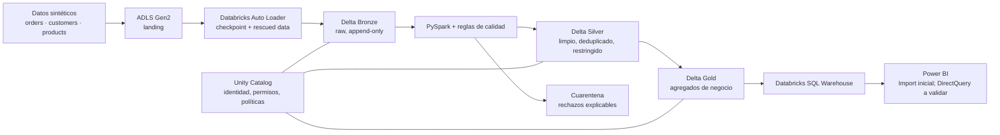

# TT E-commerce Lakehouse

Proyecto de portfolio para diseñar un e-commerce ficticio de material de tenis de mesa y su plataforma analítica gobernada en Azure. El objetivo no es operar una tienda real: es demostrar cómo transformar eventos de venta sintéticos en métricas fiables para negocio, manteniendo el acceso a datos personales bajo control.

> **Estado actual:** documentación y diseño inicial. No se han creado recursos de Azure, datos, notebooks, Terraform ni dashboards todavía.

## Problema y narrativa comercial

La tienda ficticia vende palas, gomas, pelotas, mesas, redes y accesorios. Operaciones y comercial quieren responder preguntas como:

- ¿Qué categorías, regiones y canales generan más ingresos y pedidos?
- ¿Qué productos tienen mejor rotación y qué pedidos se han reembolsado?
- ¿Cómo evoluciona la facturación diaria sin exponer datos de contacto de clientes a quienes solo consumen BI?

La fuente operativa se simulará con archivos o eventos de pedidos, clientes y catálogo. La plataforma conservará el origen para trazabilidad, depurará y conformará los datos antes de publicar agregados aptos para análisis.

## Objetivos y alcance

### MVP

- Datos **sintéticos** reproducibles: pedidos JSON y archivos CSV de clientes y catálogo, con casos de duplicados, anulaciones, nulos y cambios de esquema controlados.
- Lago en ADLS Gen2 y carga incremental a Delta Bronze mediante Databricks Auto Loader, con checkpoints y captura de registros no interpretados (`rescued data`).
- Transformaciones PySpark a Silver: contrato de esquema, tipado, deduplicación idempotente, reglas de calidad, cuarentena y columnas de auditoría.
- Unity Catalog para gobernanza: catálogos/esquemas, permisos mínimos y políticas de enmascaramiento dinámico de email y teléfono para grupos concretos.
- Tablas Gold agregadas sin columnas PII previstas para consumo general, consultables desde SQL Warehouse y un informe Power BI inicial.
- Terraform como infraestructura declarativa, con estado remoto protegido cuando se disponga del backend; el estado y las credenciales nunca se versionarán.

### Ampliaciones (fuera del MVP)

- CDC o streaming de pedidos, SCD tipo 2 para clientes/productos y orquestación programada.
- Alertas operativas, catálogo/lineage más completo, pruebas de rendimiento y despliegue CI/CD.
- Análisis avanzado de riesgo de reidentificación y controles adicionales para combinaciones de dimensiones; los criterios básicos de publicación ya forman parte del MVP.
- Evaluación de DirectQuery frente a Import en Power BI según latencia, modelo semántico y coste del SQL Warehouse.

## Arquitectura propuesta

Flujo esperado:

1. Un generador determinista produce datos sintéticos y un manifiesto de ejecución.
2. Los archivos llegan al área `landing` de ADLS. Auto Loader descubre únicamente archivos nuevos y persiste el progreso en su checkpoint.
3. Bronze almacena el payload recibido, metadatos de ingestión, archivo origen y sistema fuente de forma append-only.
4. Silver aplica el contrato, normaliza tipos y códigos, conserva columnas de auditoría y hace `MERGE` idempotente sobre una clave de negocio y una marca de evento/versión. Los registros inválidos se desvían a cuarentena, no se corrigen silenciosamente.
5. Gold recalcula ventanas explícitas sobre una instantánea completa de Silver y publica métricas de pedidos, ingresos, categoría, región y estado. Un refresco debe poder eliminar resultados obsoletos de una fecha sin alterar fechas fuera de su ventana.

## Modelo de datos inicial

| Entidad | Ejemplos de campos | Uso |
| --- | --- | --- |
| `orders` | `order_id`, `line_id`, `customer_id`, `product_id`, `order_date`, `status`, `quantity`, `revenue`, moneda | Hechos de venta, devolución o cancelación. Grano inicial: línea de pedido (`order_id` + `line_id`). |
| `customers` | `customer_id`, país/región, email, teléfono, fechas de auditoría | Relación con cliente; datos de contacto sintéticos y restringidos. |
| `products` | `product_id`, nombre, categoría, marca, precio | Dimensión de catálogo: palas, gomas, pelotas, mesas y accesorios. |

La deduplicación de pedidos se definirá sobre `order_id` + `line_id` y una versión/marca temporal de evento; una corrección o devolución debe sustituir el estado vigente de esa línea sin borrar la evidencia Bronze. Las métricas de ingresos usarán líneas completadas conforme a la definición acordada, mientras que los pedidos se contarán como `count(distinct order_id)` para no inflarlos por número de líneas. Las claves, formatos, volumen y semántica definitiva se documentarán como contratos antes de implementar. Los datos sintéticos no deben copiar identidades ni contactos reales.

## Capas, consumidores y acceso

| Capa | Propósito | Consumidores permitidos previstos |
| --- | --- | --- |
| Bronze | Evidencia raw e inmutable para replay y diagnóstico. | Ingeniería de datos con necesidad operativa. |
| Silver | Datos limpios y conformados; puede contener identificadores y contacto controlado. | Ingeniería y stewardship con necesidad justificada; analistas autorizados, únicamente mediante una vista/subconjunto aprobado con contacto enmascarado. No se abrirá de forma indiscriminada. |
| Cuarentena | Filas rechazadas y motivo de rechazo. | Ingeniería de datos / soporte autorizado. |
| Gold | Métricas y dimensiones de negocio publicadas. | Analítica, SQL Warehouse y Power BI según permisos. |

Los roles/grupos concretos se crearán o mapearán a identidades reales disponibles en el tenant; estos nombres son provisionales y no sustituyen esa verificación:

| Grupo | Acceso previsto |
| --- | --- |
| `data-engineers` | Bronze/Silver/cuarentena necesarios para operar pipelines; email/teléfono originales solo si su función lo requiere. |
| `customer-data-stewards` | Subconjunto Silver justificado para gestión de datos de cliente; contacto original. |
| `silver-analysts-authorized` | Solo una vista o subconjunto Silver aprobado; email/teléfono enmascarados dinámicamente. Sin `SELECT` general sobre tablas Silver. |
| `bi-executives` | Solo vistas/tablas Gold publicadas a través del SQL Warehouse/Power BI; sin Bronze, Silver ni cuarentena. |

Unity Catalog combinará privilegios de catálogo, esquema, tabla y vistas desde la creación de cada capa. El enmascaramiento dinámico de email/teléfono diferencia al grupo autorizado para ver el original de `silver-analysts-authorized`, pero **no** concede acceso por sí mismo: primero se restringe la tabla o vista y después se concede el mínimo `SELECT` necesario. Las pruebas de acceso se ejecutarán con identidades reales representativas, no solo como administrador.

Gold evitará publicar PII por diseño. Eso no garantiza que un agregado de baja cardinalidad no permita inferencias; antes de exponerlo se definirán criterios de tamaño mínimo, supresión o generalización acordes al caso de uso.

## Seguridad y gestión de datos

- Principio de mínimo privilegio entre identidades administradas, ADLS, Databricks, Unity Catalog y consumidores BI.
- Secretos en Key Vault o en el mecanismo corporativo aprobado, referenciados en tiempo de ejecución. No habrá secretos, tokens, ficheros de estado Terraform ni valores de configuración sensibles en Git.
- Si se necesitan identificadores derivados, se evaluará un hash con salt gestionado como secreto y rotación. Un hash no equivale automáticamente a anonimización ni elimina la necesidad de controles de acceso.
- Minimización, retención, borrado y auditoría son objetivos de diseño pendientes de concretar con requisitos de negocio y plataforma. Este proyecto no declara certificación ni cumplimiento GDPR.

## Stack previsto

- Azure Data Lake Storage Gen2 para aterrizaje y almacenamiento Delta.
- Azure Databricks: Auto Loader, PySpark, Delta Lake, Workflows y SQL Warehouse.
- Unity Catalog para metadatos, permisos, auditoría disponible y políticas de columnas.
- Power BI para el consumo de Gold.
- Terraform para infraestructura y configuración que el proveedor soporte en el entorno elegido; se validará la cobertura y los prerrequisitos al implantar.
- Python/PySpark, SQL, pruebas de calidad y CI para el código de datos.

## Decisiones, prerrequisitos y coste

- Unity Catalog requiere que el workspace, metastore, almacenamiento administrado/external locations, identidades y permisos se preparen de forma compatible con la configuración Azure/Databricks elegida. Esta secuencia se validará antes de automatizarla.
- El estado remoto de Terraform debe usar un backend protegido con bloqueo y acceso mínimo. Para experimentación local del MVP podría emplearse estado local **sin versionarlo**, pero no es una opción de colaboración ni producción.
- La topología final, SKU, horarios de apagado, retención y tamaño de cómputo se decidirán tras una estimación de volumen y presupuesto. Se priorizarán jobs efímeros, límites de coste y apagado del SQL Warehouse.
- Algunas operaciones de Databricks/Azure pueden requerir pasos administrativos o no estar disponibles en la versión del provider elegida; se comprobarán en el momento de despliegue en vez de asumir soporte total.

## Ejecución prevista

Cuando se implemente, el repositorio documentará los comandos y variables exactos. A alto nivel, la ejecución será:

1. Configurar suscripción/tenant, identidades, backend de Terraform y permisos requeridos.
2. Aplicar infraestructura revisada y configurar el metastore/Unity Catalog según los prerrequisitos validados.
3. Generar datos sintéticos, subirlos al área de aterrizaje y ejecutar la ingesta Bronze.
4. Ejecutar Silver, revisar cuarentena y métricas de calidad; solo entonces refrescar Gold.
5. Probar permisos con cada identidad de prueba y conectar Power BI al SQL Warehouse autorizado.

No hay comandos ejecutables ni recursos desplegados aún.

## Roadmap

El plan por fases, dependencias, entregables y criterios verificables está en [docs/PLAN_DE_DESARROLLO.md](docs/PLAN_DE_DESARROLLO.md).
