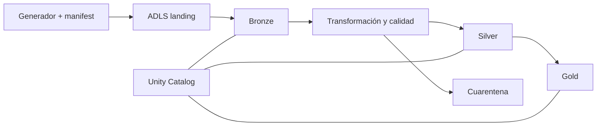

# TT E-commerce Lakehouse

> **Idioma:** Español · [English](README.en.md)

Lakehouse gobernado que transforma datos de e-commerce 100 % sintéticos en métricas analíticas, con contratos, calidad y controles de acceso. No es una tienda operativa ni procesa datos de personas reales.

## Qué demuestra

El hito realizado recorre un lote con contrato desde el generador y su manifest hasta una métrica Gold protegida. SQL Warehouse y Power BI son trabajo futuro/no iniciado; no forman parte del flujo ejecutado.



- El generador produce un lote determinista con archivos y manifest.
- Bronze conserva la ingesta raw; Silver aplica el contrato y separa rechazos en cuarentena.
- Gold publica únicamente agregados aptos para consumo analítico.

| Tramo | Evidencia versionada local |
| --- | --- |
| Generación | Script, fixture `DEMO-001` y contrato |
| Landing a Bronze | Preflight, pipeline y pruebas |
| Silver y cuarentena | Núcleo de transformación y pruebas |
| Gold | Regla de agregación k-anónima y pruebas |

El diagrama resume el camino del hito, no una arquitectura genérica de producción.
La capa de gobierno acompaña las tablas, pero no altera la separación entre datos raw,
datos conformados, rechazos y agregados publicados.

## Resultado del hito

La celda Gold vigente para **pala · ES-MD · web** es **640,00 EUR**, **5 pedidos** y **0 líneas reembolsadas**. Es la única celda publicada y cumple **k ≥ 5**.

La ejecución cloud de Bronze y del hito Silver es evidencia **reportada por el operador**: no es reproducible desde Git ni constituye una auditoría formal. El repositorio sí versiona el código, los contratos, el fixture y las pruebas locales; el detalle reportado está en el [acta de Fase 3](docs/fase-3/ACTA_EVIDENCIA_CLOUD_DEMO-001.md).

Gold no incluye PII ni identificadores en la celda publicada.
La supresión se evalúa sobre la combinación de dimensiones de esa publicación.

## Desafíos resueltos

- **Archivos no autorizados →** una auditoría del directorio se realiza antes de cualquier DDL y Auto Loader se limita al archivo aprobado mediante `pathGlobFilter`.
- **Privilegios excesivos →** el run-as de Bronze conserva `CREATE_TABLE` en Bronze y el service principal de Silver queda separado; los escritores no reciben ese privilegio en Bronze.
- **Anomalías ocultas →** el fixture mantiene JSON malformado y schema drift; `_rescued_data`, `_corrupt_record` y cuarentena conservan la evidencia, sin corrección silenciosa.
- **Dos fallos de runtime →** se corrigieron en el pipeline versionado; la evidencia de sus ejecuciones cloud sigue siendo solo reportada por el operador, no una prueba reproducible ni una auditoría. Véase [corrección del pipeline](docs/evidencia/02-correccion-del-pipeline.md).

Estas decisiones priorizan que un lote inesperado falle de forma visible o deje
evidencia revisable. No convierten la ejecución reportada en evidencia auditada.

## Verificación local

Desde la raíz del repositorio:

```powershell
py scripts/generate_synthetic_data.py --seed 42 --batch-id DEMO-001
py -m unittest discover -s tests -v
```

La suite local registra **287 pruebas en 13 suites**, sin credenciales cloud. Genera `DEMO-001` y valida contratos, pipeline y separación de privilegios; no acredita una ejecución en el workspace.

El primer comando genera el lote y el segundo ejecuta `unittest`; no requieren credenciales cloud.

## Límites y siguiente paso

- Todos los datos son sintéticos.
- La Fase 2 no está formalmente cerrada y Bronze quedó congelado tras una única ejecución reportada.
- El hito Silver está acotado: `replaceWhere` por scope; no es streaming, CDC, carga incremental genérica ni `MERGE`, y no es atómico entre sus salidas.
- Siguen sin iniciar SQL Warehouse, Power BI, CI/CD, monitorización, máscaras dinámicas y la prueba por identidad de consumidor.

La siguiente prioridad es formalizar evidencia y gates, y después incorporar CI/CD y monitorización operativa. El alcance y los pendientes constan en el [plan de desarrollo](docs/PLAN_DE_DESARROLLO.md) y en la [documentación de evidencia](docs/evidencia/README.md).

El congelamiento no sustituye los gates firmados; el scope no resuelve nuevas ventanas, cambios continuos ni coordinación transaccional.

## Documentación detallada

- [Índice de evidencia](docs/evidencia/README.md) — límites y trazabilidad.
- [Acta de evidencia cloud del hito Silver (Fase 3)](docs/fase-3/ACTA_EVIDENCIA_CLOUD_DEMO-001.md) — resultado reportado y alcance.
- [Plan de desarrollo](docs/PLAN_DE_DESARROLLO.md) — fases, gates y pendientes.
- [Contratos de Fase 0](docs/fase-0/CONTRATOS.md) — formatos y reglas del lote.
- [Decisiones de Fase 1](docs/fase-1/ARQUITECTURA_Y_DECISIONES.md) — fundación y gobierno.
- [Decisiones de Fase 2](docs/fase-2/ARQUITECTURA_Y_DECISIONES.md) — ingesta Bronze y controles.

La documentación detallada está en español.
